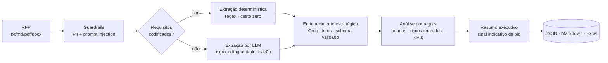

# RFP Requirements Analyzer

> Nome técnico (slug): `ia-com-rfp-analyzer-backend` · Serviço OTEL: `rfp-analyzer-v1` · Versão 1.0.0

Plataforma de IA que transforma uma RFP (txt, md, pdf, docx) em **inteligência de proposta**: matriz de
requisitos classificada, riscos cruzados entre cláusulas, lacunas de informação, perguntas de
esclarecimento priorizadas e um **sinal indicativo de bid/no-bid** — em segundos, com rastreabilidade
total e custo de IA na casa de centavos por documento.

A IA generativa roda na **Groq** (modelos Llama de alta velocidade), acessada via **LiteLLM**, o router
de LLM exigido pela stack corporativa.

---

## 1. Por que este projeto existe

Times de pré-vendas gastam de 1 a 3 dias por RFP lendo, tabulando requisitos em planilha e caçando o que
**não** está escrito (penalidades, volumetria, horário de cobertura). Os erros caros não estão no que a
RFP pede — estão no que ela omite e na combinação de cláusulas que, juntas, tornam o preço inviável.

| Antes | Com o RFP Analyzer |
|---|---|
| Tabulação manual de requisitos | Matriz Excel pronta, com colunas de aderência para o time preencher |
| Riscos percebidos (ou não) por quem leu | 7 regras de risco cruzado + checklist de 12 lacunas, auditáveis |
| Perguntas ao cliente montadas no improviso | Lista consolidada, deduplicada e priorizada |
| Decisão de bid baseada em impressão | Sinal indicativo + KPIs (índice de clareza, criticidade, riscos) |

Visão de negócio completa, KPIs de sucesso e modelo de adoção: [`docs/01-visao-estrategica.md`](docs/01-visao-estrategica.md).

## 2. Como funciona (resumo)



**Princípio de arquitetura:** _o LLM opina, as regras decidem, o humano aprova._ O LLM nunca altera o
texto de um requisito, nunca declara aderência e nunca toma a decisão de bid. Tudo que é fato
(extração, métricas, lacunas, riscos) é determinístico e testável; o LLM adiciona interpretação
(resumo, ambiguidades, perguntas, evidências sugeridas). Detalhes em [`docs/02-arquitetura.md`](docs/02-arquitetura.md).

## 3. Início rápido

```bash
python -m venv .venv && source .venv/bin/activate
pip install -e ".[dev,pdf,docx]"
cp .env.example .env            # preencha GROQ_API_KEY (nunca commitar o .env)

# Análise com IA (Groq)
rfp-analyzer analyze tests/fixtures/rfp_ficticia_field_services.txt --out output/

# Análise sem IA (modo determinístico, custo zero — útil para triagem e quando a Groq está fora)
rfp-analyzer analyze tests/fixtures/rfp_ficticia_field_services.txt --out output/ --offline

# API REST
uvicorn rfp_analyzer.api.main:app --reload --port 8080
# → http://localhost:8080/docs
curl -F "file=@tests/fixtures/rfp_ficticia_field_services.txt" "http://localhost:8080/v1/analyses?use_llm=true"

# Qualidade
make check        # ruff + mypy --strict + pytest (25 testes, sem rede, sem custo)
```

Saídas geradas em `output/`:

| Arquivo | Para quem | Conteúdo |
|---|---|---|
| `relatorio.md` | Comitê / gestores | Resumo executivo, riscos, lacunas, perguntas, matriz |
| `matriz_requisitos.xlsx` | Time de proposta | Abas Resumo, Matriz (com validação de aderência), Riscos, Lacunas, Perguntas |
| `analysis.json` | Integrações (n8n, Zeev, BI) | Contrato completo `AnalysisResult` |

Um exemplo real gerado a partir da RFP fictícia está em [`examples/saida_rfp_ficticia/`](examples/saida_rfp_ficticia/).

## 4. Configuração

Todas as opções são variáveis de ambiente (ver [`.env.example`](.env.example)). As principais:

| Variável | Padrão | Função |
|---|---|---|
| `GROQ_API_KEY` | — | Credencial Groq. **Secret**, nunca ConfigMap. |
| `LLM_PRIMARY_MODEL` | `groq/llama-3.3-70b-versatile` | Modelo principal (qualidade). |
| `LLM_FALLBACK_MODEL` | `groq/llama-3.1-8b-instant` | Fallback (disponibilidade/custo). Pode apontar para outro provider. |
| `LLM_TIMEOUT_SECONDS` | `25` | Menor que o timeout do ingress, para o fallback ter tempo de rodar. |
| `LLM_MAX_TOKENS_PER_ANALYSIS` | `120000` | Circuit breaker de custo por documento. |
| `LLM_ENABLED` | `true` | `false` força o modo determinístico. |
| `PII_REDACTION_ENABLED` | `true` | Mascara CPF, CNPJ, e-mail, telefone e cartão antes do envio ao LLM. |

Trocar de provider (ex.: IA Box soberana, Azure OpenAI) é só configuração — o código fala com o LiteLLM.

## 5. Índice de Clareza

`indice_clareza = max(0, 100 − Σ peso(lacunas) − 2 × ambiguidades)`, com pesos ALTA=8, MEDIA=4, BAIXA=2.
É uma métrica **comparativa** entre RFPs (quanto menor, maior o risco de precificar no escuro), não uma
nota absoluta. A RFP fictícia de exemplo marca **26/100** — coerente com a ausência de volumetria,
penalidades e horário de cobertura.

## 6. Estrutura do repositório

```
src/rfp_analyzer/
├── domain/models.py        # Contrato do sistema (Pydantic) — API, relatórios e LLM convergem aqui
├── ingestion/              # Loaders (txt/md/pdf/docx) e segmentador determinístico
├── security/pii.py         # Mascaramento de PII + detecção de prompt injection
├── llm/                    # Porta LLMGateway + adapter LiteLLM/Groq + prompts versionados
├── prompts/*.yaml          # Prompts versionados (nunca hardcoded)
├── pipeline/               # extract → enrich → analyze → summarize (SRP por etapa) + orchestrator
├── reporting/              # Markdown e Excel
├── api/main.py             # FastAPI (/health, /ready, /v1/analyses)
└── cli.py                  # Typer
docs/                       # Visão, arquitetura, segurança, operação, roadmap, ADRs, exceções
tests/                      # 25 testes (dublês de LLM — sem rede e sem custo)
```

## 7. Documentação

| Documento | Conteúdo |
|---|---|
| [01 — Visão estratégica](docs/01-visao-estrategica.md) | Problema, proposta de valor, KPIs, adoção |
| [02 — Arquitetura](docs/02-arquitetura.md) | C4 (contexto, contêiner, componente), fluxo, NFRs, classificação Tier |
| [03 — Segurança e compliance](docs/03-seguranca-compliance.md) | Ameaças, guardrails, LGPD, OWASP LLM |
| [04 — Operação e FinOps](docs/04-operacao-finops.md) | Deploy, observabilidade, runbooks, custo |
| [05 — Roadmap](docs/05-roadmap.md) | Evolução em fases |
| [00 — Exceções](docs/00-excecoes.md) | Uso da Groq (fora da stack aprovada) |
| [ADRs](docs/adr/) | Decisões arquiteturais registradas |

---
Documento fictício de exemplo: os dados da RFP em `tests/fixtures/` são totalmente fictícios e servem
apenas para demonstração.
