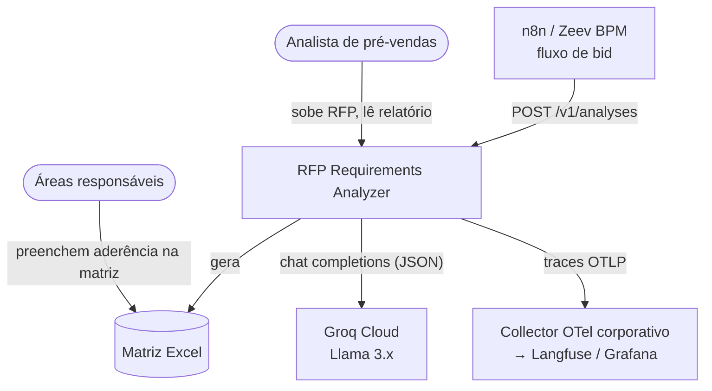
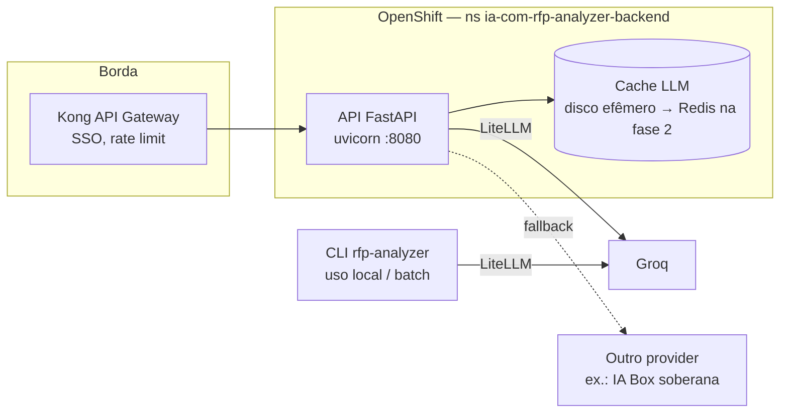
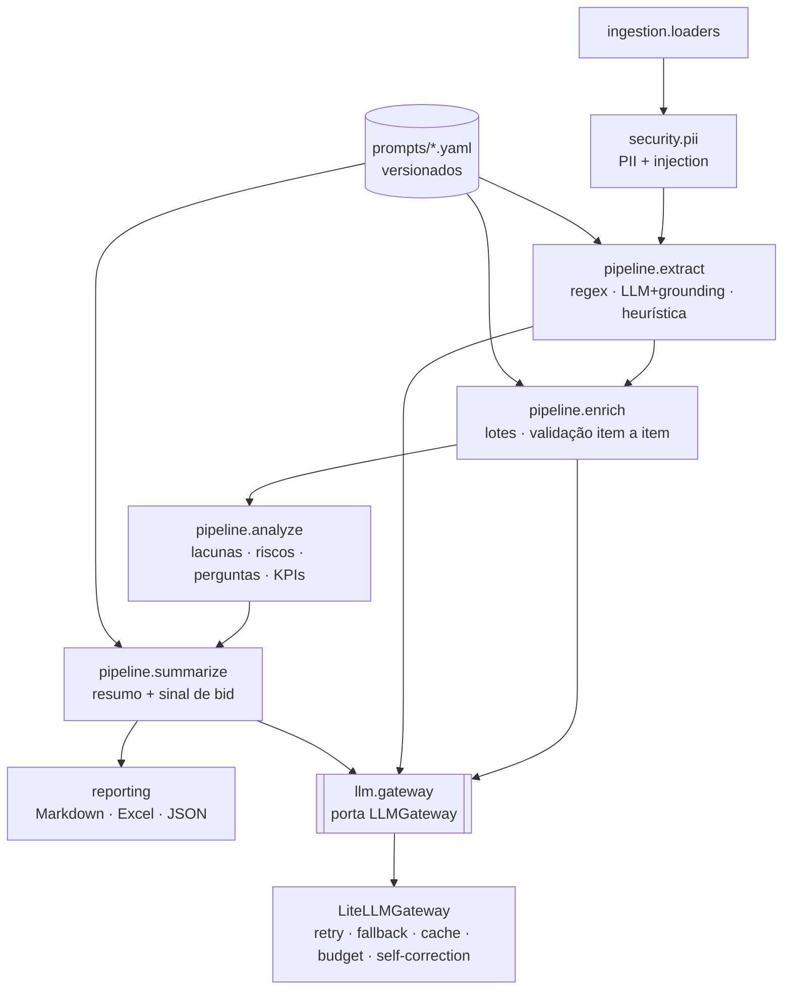
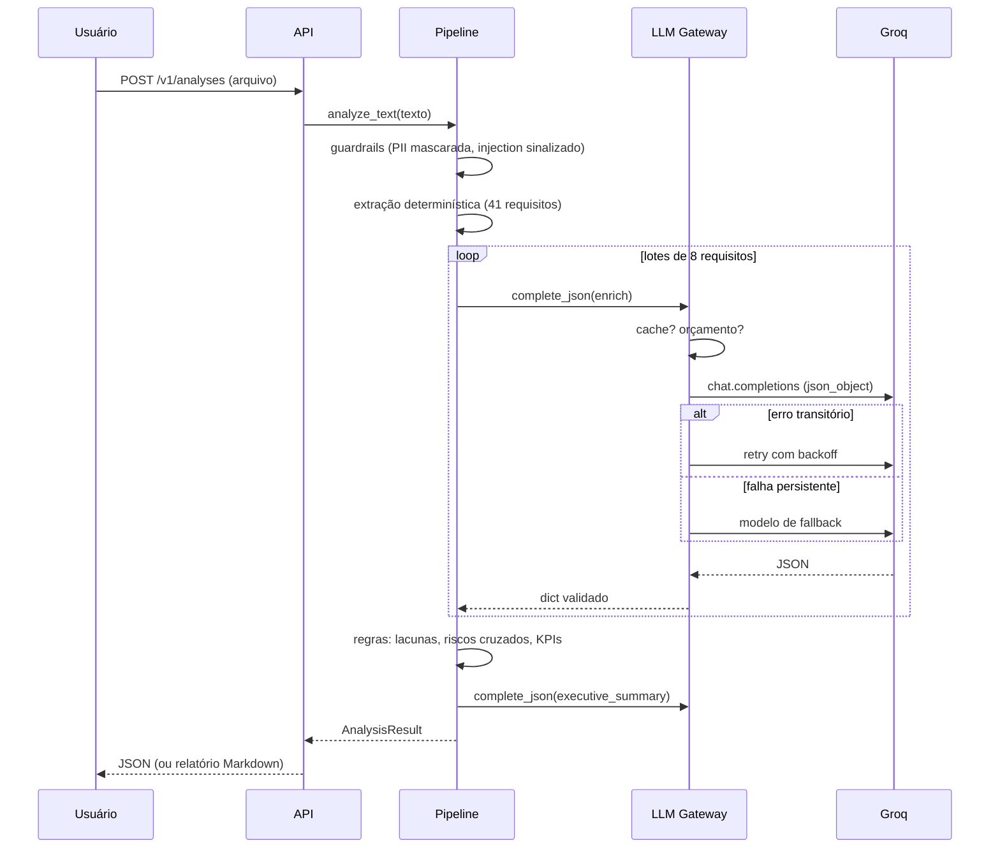

# 02 — Arquitetura

## Classificação

**Tier 2 IA (Assistido).** O sistema resume, classifica e analisa documentos, **não executa ações de
escrita** em sistemas de produção e não decide nada sozinho. Exigências do tier atendidas: logs
estruturados, gestão de custo de tokens e API versionada (`/v1`). Itens de Tier 1 (fallback de LLM,
observabilidade OTel completa) já estão implementados por serem baratos e úteis.

## C4 — Nível 1: Contexto

## C4 — Nível 2: Contêineres

## C4 — Nível 3: Componentes (pipeline)

Cada etapa tem uma única responsabilidade (sem "God Agent") e conversa com o LLM apenas pela porta
`LLMGateway` — o que permite testar o pipeline inteiro com dublês, sem rede.

## Fluxo de uma análise

## Decisões principais (ver ADRs)

| ADR | Decisão |
|---|---|
| [ADR-001](adr/ADR-001-groq-via-litellm.md) | Groq como provider primário, sempre via LiteLLM |
| [ADR-002](adr/ADR-002-extracao-hibrida.md) | Extração híbrida: regex primeiro, LLM só quando necessário |
| [ADR-003](adr/ADR-003-grounding-anti-alucinacao.md) | Grounding: todo trecho extraído por LLM precisa existir no documento |
| [ADR-004](adr/ADR-004-regras-deterministicas.md) | Lacunas e riscos como regras em código, não como prompt |
| [ADR-005](adr/ADR-005-degradacao-graciosa.md) | Degradação graciosa: o sistema nunca devolve vazio por falha do LLM |

## Requisitos não funcionais

| Requisito | Como é atendido |
|---|---|
| Latência | Groq (inferência rápida) + lotes de 8 requisitos; modo offline em milissegundos |
| Resiliência | Retry com backoff, fallback de modelo, timeout de 25 s, modo heurístico |
| Custo | Extração por regex (zero tokens), cache por hash do prompt, teto de tokens por análise |
| Confiabilidade da saída | `response_format=json_object`, validação Pydantic item a item, self-correction de JSON |
| Rastreabilidade | `trace_id`, SHA-256 do documento, versões de prompt e modelos usados em cada resultado |
| Testabilidade | Porta `LLMGateway` + dublês: 25 testes sem rede e sem chave |
| Portabilidade | 12-factor (env vars), contêiner UBI não-root, provider trocável por configuração |

## Pontos de extensão

- **Novo provider:** alterar `LLM_PRIMARY_MODEL`/`LLM_FALLBACK_MODEL` (qualquer modelo suportado pelo LiteLLM).
- **Nova regra de risco:** função em `pipeline/analyze.py` + entrada em `RISK_RULES` + teste.
- **Novo tópico de lacuna:** item em `COVERAGE_CHECKLIST`.
- **Novo formato de saída:** módulo em `reporting/` consumindo `AnalysisResult`.
